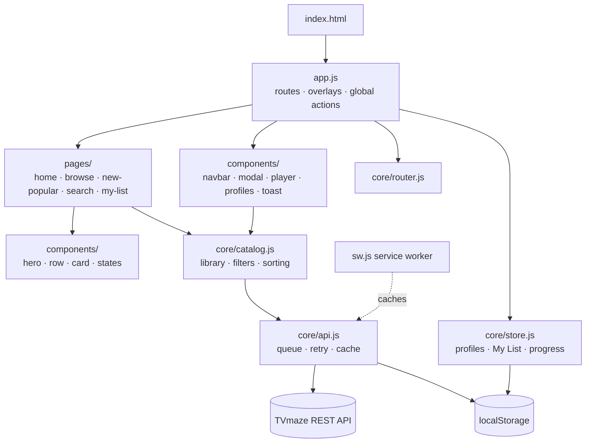
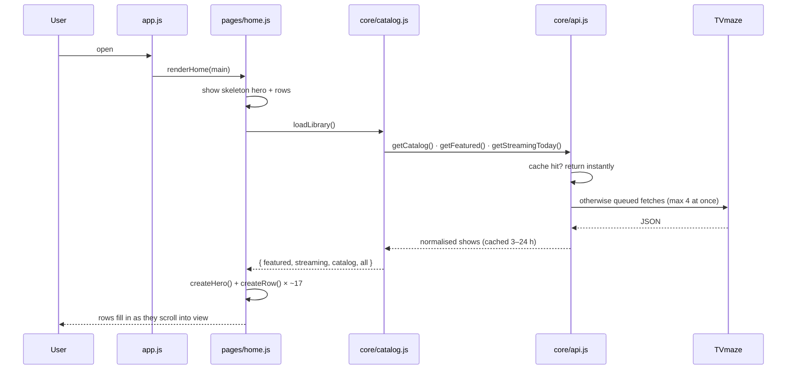

# Reelora: Project Notes

> Personal study notes for **Reelora**, a streaming-style TV discovery web app.
> They explain what the project does, how every module works, and how to talk about it in interviews.

- **Live site:** https://insofury.github.io/reelora/
- **Source code:** https://github.com/Insofury/reelora
- **Author:** Ashish Chahar
- **Built:** November 2026

---

## Contents

1. [The 30-second pitch](#1-the-30-second-pitch)
2. [What a visitor can do](#2-what-a-visitor-can-do)
3. [Tech stack and why](#3-tech-stack-and-why)
4. [Architecture](#4-architecture)
5. [Folder structure](#5-folder-structure)
6. [Module-by-module guide](#6-module-by-module-guide)
7. [Data: the TVmaze API](#7-data-the-tvmaze-api)
8. [Routes](#8-routes)
9. [State and browser storage](#9-state-and-browser-storage)
10. [Caching strategy](#10-caching-strategy)
11. [Performance techniques](#11-performance-techniques)
12. [Accessibility](#12-accessibility)
13. [Security](#13-security)
14. [Responsive design](#14-responsive-design)
15. [PWA and offline support](#15-pwa-and-offline-support)
16. [How it was tested](#16-how-it-was-tested)
17. [Run, edit and deploy](#17-run-edit-and-deploy)
18. [Known limitations](#18-known-limitations)
19. [Ideas to extend it](#19-ideas-to-extend-it)
20. [Interview questions and answers](#20-interview-questions-and-answers)
21. [Glossary](#21-glossary)

---

## 1. The 30-second pitch

> "Reelora is a streaming-platform-style web app I built from scratch in vanilla JavaScript. It pulls real TV data from the
> public TVmaze API and offers profiles with a Kids filter, a billboard, Top 10 and genre rows, a details pop-up with episodes and
> cast, live search, a My List per profile, and a custom video player that remembers where you stopped. There's no framework
> and no build step: I wrote a small hash router, a reactive localStorage store and an API layer with request queuing, retries
> and two-level caching. It's an installable PWA, works offline for the app shell, is keyboard accessible and is deployed on
> GitHub Pages."

---

## 2. What a visitor can do

| Step | What happens | Where in the code |
| --- | --- | --- |
| 1. Open the site | "Who's watching?" screen with 3 default profiles (Ashish, Guest, Kids) | `components/profiles.js` |
| 2. Pick a profile | Home page loads: billboard + rows. Kids profile hides mature genres | `pages/home.js`, `core/catalog.js` |
| 3. Hover a poster (desktop) | Card grows and shows Play, +, More-info buttons, rating, genres | `components/card.js`, CSS §8 |
| 4. Click a poster | Details pop-up: backdrop, synopsis, cast, seasons and episodes, More Like This | `components/modal.js` |
| 5. Press Play | Full-screen player with a demo movie; progress is saved | `components/player.js` |
| 6. Come back | "Continue Watching for <name>" row appears and resumes at the saved second | `core/store.js`, `pages/home.js` |
| 7. Press + | Show saved to My List (per profile); a toast confirms it | `app.js`, `core/store.js`, `components/toast.js` |
| 8. Search | Type in the nav search; results update live (debounced) | `components/navbar.js`, `pages/search.js` |
| 9. Browse | Grid of every series, genre chips and sort (popular, rating, newest, A–Z) | `pages/browse.js` |
| 10. Install | "Install app" from the browser; opens like a native app | `manifest.webmanifest`, `sw.js` |

Keyboard shortcuts: `/` opens search, `Esc` closes pop-ups. In the player: `Space`/`K` play/pause, `←`/`→` seek 10 s, `F` full screen, `M` mute.

---

## 3. Tech stack and why

| Choice | Why |
| --- | --- |
| **Vanilla JavaScript (ES modules)** | Shows a real understanding of the DOM, events, modules and async code without hiding it behind a framework. No build step means the source *is* what runs, and GitHub Pages hosts it directly. |
| **Hash router** | `#/title/169` URLs need no server rewrites (GitHub Pages can't do them), every screen is shareable, and Back/Forward just work. |
| **TVmaze API** | Free, no API key, supports browser requests (CORS), and has posters, backdrops, cast, seasons and episodes. |
| **localStorage store with events** | Profiles, My List and progress survive reloads without a backend; components subscribe to changes, a tiny version of what Redux or Zustand do. |
| **Native `<dialog>`** | Built-in focus trapping, Esc handling and an inert background, so it's accessible by default. |
| **Service worker + manifest** | Makes it installable (PWA) and keeps the app shell working offline. |
| **CSS custom properties + Grid + scroll-snap** | Theming from one place; carousels without a library; layout adapts from phones to 4K. |

---

## 4. Architecture

The code is layered: **core** (data, no UI) → **components** (reusable UI) → **pages** (screens) → **app.js** (wiring).
Lower layers never import from higher ones.



### What happens when the home page loads



---

## 5. Folder structure

```
reelora/
├── index.html              Page shell: nav, <main>, footer, <dialog>, overlay roots
├── css/styles.css          One stylesheet, 15 numbered sections
├── js/
│   ├── app.js              Entry point & controller
│   ├── core/               Data and plumbing (no UI)
│   │   ├── api.js
│   │   ├── catalog.js
│   │   ├── router.js
│   │   ├── store.js
│   │   └── utils.js
│   ├── components/         Reusable UI
│   │   ├── brand.js  card.js  hero.js  icons.js  modal.js  navbar.js
│   │   ├── player.js  profiles.js  row.js  states.js  toast.js
│   └── pages/              One file per screen
│       ├── home.js  browse.js  new-popular.js  search.js  my-list.js
├── sw.js                   Service worker
├── manifest.webmanifest    PWA manifest
├── assets/                 favicon.svg, logo.svg, icon-192/512.png, og-image.png
├── README.md               GitHub front page
├── NOTES.md                This file
└── LICENSE                 MIT
```

---

## 6. Module-by-module guide

### `index.html`: the shell
- Loads fonts (Inter for text, Sora for headings), `css/styles.css` and **one** script: `<script type="module" src="js/app.js">`. Modules are deferred automatically, so the HTML renders first.
- Static containers the JS fills: `#nav`, `#main`, `#title-modal` (`<dialog>`), `#player-root`, `#gate-root`, `#toast`.
- SEO and social meta tags (`og:image` is the branded preview card) plus favicon, apple-touch-icon and manifest links.
- `preconnect` hints to `api.tvmaze.com` and `static.tvmaze.com` speed up the first request.
- Footer credits TVmaze and Blender, as their licences require.

### `css/styles.css`: the design system
Organised in numbered sections: **tokens → base → buttons → nav → avatars → hero → rows → cards → skeletons → pages → modal → player → gate → toast/footer → responsive**.
- **Tokens** (`:root`): colours (`--bg`, `--accent` teal, `--accent-2` violet), gradient, spacing (`--gutter` scales with `clamp()`), fonts.
- **Rows**: `display: grid; grid-auto-flow: column` with `grid-auto-columns: calc((100% - gap × (cols − 1)) / cols)`, so exactly `--cols` posters fit the screen. `--cols` changes at breakpoints (3 → 4 → 5 → 6 → 7). `scroll-snap` makes swipes land on a poster.
- **Hover cards** only on real mouse devices: `@media (hover: hover) and (pointer: fine)`. Touch users tap straight into the details.
- **Top 10 numbers** are outlined text (`-webkit-text-stroke`) in the background colour, with a fixed 40/60 split so posters stay the same size.
- **Skeletons** use an animated gradient (`@keyframes shimmer`) while data loads.
- **`prefers-reduced-motion`** turns animations off for users who ask for that.

### `js/app.js`: entry point and controller
- **Registers routes** (see §8) and decides what to render.
- Keeps one **"base page"** rendered underneath overlays. Opening a title (`#/title/169`) shows the pop-up *over* the current page instead of replacing it; `ensureBase()` renders Home underneath if you arrive by a direct link.
- `leaveOverlay()`: closing a pop-up goes **Back** if you came from inside the app, otherwise to the page underneath, so the browser Back button and the close button behave the same.
- **Event delegation**: one `click` listener on `document` handles every `data-action="play | info | list"` button anywhere (cards, hero, modal, episodes). New cards need no new listeners.
- **Reacts to store events**: `list` updates every +/✓ button and the My List row; `profile` re-renders the page; `progress` refreshes Continue Watching when the player closes.
- Registers the **service worker** (HTTPS or localhost only).
- Global shortcut: `/` opens search.

### `js/core/utils.js`: helpers
| Function | Purpose |
| --- | --- |
| `$`, `$$` | Short `querySelector` / `querySelectorAll` |
| `esc(value)` | **Escapes HTML** (`& < > " '`); used for every API string inserted into markup |
| `stripTags(html)` | Turns TVmaze's HTML summaries into plain text using `DOMParser` (never executes scripts) |
| `truncate(text, max)` | Cuts on a word boundary and adds `…` |
| `el(markup)` | Builds one element from an HTML string via `<template>` |
| `debounce(fn, ms)` | Delays a function until typing pauses (search) |
| `safeUrl(url)` | Allows only `http(s)` URLs in `href`/`src` (blocks `javascript:`) |
| `storage.get/set/remove/keys` | localStorage wrapper that never throws (private mode, quota full) |
| `formatRuntime`, `formatClock`, `isoDate` | `61 → "1h 1m"`, `75 → "1:15"`, today as `YYYY-MM-DD` |
| `uniqueBy`, `pickRandom`, `prefersReducedMotion` | Small utilities |

### `js/core/api.js`: the network layer (the only file that calls `fetch`)
1. **Concurrency limiter**: at most **4 requests at once** (`limited()` queue). TVmaze allows ~20 requests per 10 seconds.
2. **`fetchJson(path)`**: 15-second timeout via `AbortController`; on **HTTP 429** (rate limited) waits 1.5 s, 3 s, 6 s… and retries (exponential back-off); network errors retry twice.
3. **`cached(key, {ttl, persist}, producer)`**: checks memory (`Map`) → localStorage → otherwise runs the request **once**, even if several components ask at the same moment (the in-flight promise is shared).
4. **`normalizeShow(raw)`**: reduces a large TVmaze object to the ~18 fields the UI uses (`id, name, genres, rating, weight, poster, posterLarge, summary, year, runtime, network…`). Smaller objects mean faster rendering and a smaller cache.
5. Public functions:

| Function | Endpoint | Cache |
| --- | --- | --- |
| `getCatalog()` | `/shows?page=0,1,2` (≈750 shows) | 24 h, localStorage |
| `getFeatured()` | `/singlesearch/shows?q=<title>` × 16 popular series | 24 h, localStorage |
| `getStreamingToday()` | `/schedule/web?date=<today>` | 3 h, localStorage (old days pruned) |
| `getArtwork(id)` | `/shows/:id/images` → backdrop + title logo | 7 days, localStorage |
| `getShowDetails(id)` | `/shows/:id?embed[]=cast&embed[]=episodes&embed[]=seasons` | 6 h, memory only (can be large) |
| `searchShows(q)` | `/search/shows?q=` | 1 h, memory only |

### `js/core/catalog.js`: the library
- `loadLibrary()` runs the three list requests **in parallel** with `Promise.allSettled`, so one failing source doesn't break the page. It merges them into `{ featured, streaming, catalog, all }` (de-duplicated). The promise is reused; if *everything* fails it resets so "Try again" can retry.
- **Registry** (`remember()` / `lookup(id)`): a `Map` of every show seen. When a button with `data-id="169"` is clicked, the app finds the show's data here. New non-empty fields win; empty ones never erase good data.
- **Kids filter** (`isKidSafe`, `forProfile`): blocks Horror, Crime, Thriller, War, Adult, Espionage, Medical, Legal, Supernatural and requires a family-friendly genre or Animation.
- **Sorting**: `byPopularity` (TVmaze `weight`), `byRating`, `byNewest`, `byName`.
- **`similarTo(show, pool)`**: "More Like This" scores other shows by the number of shared genres, then by popularity.
- `GENRE_ROWS`: the 13 genre rows and their friendly titles ("Sci-Fi Worlds", "Watch Together"…).

### `js/core/router.js`: hash router
- `addRoute('/title/:id', handler)` turns the pattern into a regex and captures `:id`.
- `resolve()` reads `location.hash`, splits off `?query`, finds the first matching route and calls its handler with `{ params, query }`; otherwise the fallback runs (redirects home).
- `navigate(path, { replace })` either sets `location.hash` (adds a history entry) or uses `history.replaceState` (used while typing in search, so each keystroke doesn't create a Back step).
- `navigationCount()` tells the app whether Back would stay inside the site.

### `js/core/store.js`: user state
- **Profiles**: defaults are Ashish, Guest and Kids (`kids: true`); up to 5. `addProfile`, `removeProfile` (also deletes that profile's list and progress), `setActiveProfile`.
- **My List**: `myList()`, `inList(id)`, `toggleList(show)`; stores a *mini* copy of each show so the list renders without another request.
- **Continue Watching**: `saveProgress(show, position, duration)`, `resumePosition(id)`, `continueWatching()` (watched more than 5 s and less than 95 %).
- **Events**: `subscribe(fn)` gets `'profile' | 'profiles' | 'list' | 'progress'`.
- **In-memory copy**: values are parsed from localStorage once and kept in a `Map`. Rendering 400 cards asks "is this in My List?" 400 times, so this matters.
- Listens to the browser's `storage` event so **two open tabs stay in sync**.

### `js/components/icons.js` and `brand.js`
- Inline SVG strings (play, pause, plus, check, chevrons, volume, full screen…). No icon font and no extra requests; all `aria-hidden`.
- `markSVG()` draws the Reelora mark (gradient film reel with a play triangle); each copy gets a unique gradient id.

### `js/components/card.js`: poster cards
- `cardMarkup(show, { rank })` returns an `<li>` with the poster link (`#/title/:id`) plus a hover panel (Play, +/✓, More info, title, ★ rating, year, runtime, genres). `rank` adds the Top 10 number.
- `listButton(show, { labeled })` is the +/✓ toggle; `syncListButtons()` updates every copy on the page after a change.
- `posterImg()` uses `loading="lazy"`, `decoding="async"` and fixed `width`/`height` (no layout shift); shows a text fallback if there's no poster.

### `js/components/row.js`: carousels
- `createRow({ title, shows, ranked, href })` builds a heading, an "Explore all" link and the scrolling track.
- **Lazy rendering**: the row starts with 8 skeleton cards; an `IntersectionObserver` (500 px early) builds the real cards only when the row is about to be seen. The home page has ~17 rows (~470 posters), so this keeps the first load fast.
- Arrow buttons scroll 90 % of the visible width (smooth unless reduced motion is on) and hide at the ends (`ResizeObserver` + scroll listener throttled with `requestAnimationFrame`). On touch devices the arrows are hidden and you swipe.

### `js/components/hero.js`: billboard
- Picks a random show from the top 8 featured series.
- Renders **immediately** with a blurred poster, then swaps in the landscape **backdrop** and the show's **title logo** from `getArtwork()`, fading in when loaded.
- Buttons: Play, More Info, and +.

### `js/components/modal.js`: title details
- Uses the native `<dialog>` with `showModal()` (focus trap, Esc, inert background). Esc and backdrop clicks go through the router so Back works.
- A **request token** ignores slow responses from a title you already left (prevents "flash of the wrong show").
- Sections: hero with Play and My List · meta (★, years, seasons, runtime, status) · synopsis · Cast/Genres/Network · **season `<select>`** with episode list (thumbnail, runtime, summary) · cast photos · **More Like This** (8 similar shows) · About with links to Official site and TVmaze.

### `js/components/player.js`: video player
- TVmaze has no video, so every title plays the open movie ***Big Buck Bunny*** (CC BY 3.0) from Wikimedia Commons (WebM), with an MP4 fallback.
- **Custom controls**: play/pause, ±10 s, seek bar (filled with a CSS variable), volume, mute, full screen, time display, auto-hiding controls and cursor after 2.8 s.
- **Keyboard**: Space/K, ←/→, F, M, Esc.
- **Progress**: saves every 5 s, on pause and on close; on reopen it seeks to the saved second and shows "Resuming at 0:14".
- `closePlayer()` removes every listener it added (stored in a `cleanup` array), so nothing leaks.

### `js/components/profiles.js`: "Who's watching?"
- Full-screen picker with gradient initial avatars; **Add profile** form (name + Kids checkbox) and **Manage profiles** (delete). Esc closes only if someone is already signed in.
- `avatar(profile, size)` is reused by the nav.

### `js/components/navbar.js`
- Logo, links (Home, Browse, New & Popular, My List); on small screens these collapse into a "Browse ▾" `<details>` menu.
- **Search**: icon expands an input; typing is debounced (350 ms) and navigates to `#/search?q=…` (replacing history while typing).
- **Profile menu**: Switch profile, My List, View source. Closes on outside click or Esc.
- Transparent over the billboard, solid after scrolling 8 px.

### `js/components/states.js` and `toast.js`
- `errorState(message, onRetry)` and `emptyState({title, text, href, cta})` give friendly panels instead of blank screens.
- `toast(message)` is a `role="status"` message (read by screen readers). Because an open `<dialog>` sits in the browser's *top layer*, the toast moves inside the dialog while one is open so it stays visible.

### `js/pages/*`: screens
| Page | What it renders |
| --- | --- |
| `home.js` | Billboard; personal rows (Continue Watching, My List); Top 10; Trending; New on Streaming Today; Critically Acclaimed (★ ≥ 8.3); 13 genre rows (shown only if ≥ 6 titles). `refreshPersonalRows()` updates just the personal rows. |
| `browse.js` | Grid of all series, genre chips (20 most common genres), sort select (remembered while the app is open) |
| `new-popular.js` | Streaming today, Recently premiered, Most popular (ranked), Top rated |
| `search.js` | Stays mounted while you type; a token discards out-of-order responses; empty, error and "start typing" states |
| `my-list.js` | The active profile's saved shows, or an empty state with a call to action |

### `sw.js`: service worker
- **Install**: pre-caches the app shell (HTML, CSS, every JS module, icons).
- **Activate**: deletes caches from older versions (`VERSION = 'reelora-v1'`) and takes control.
- **Fetch**: same-origin files are **network-first** (a new deploy shows up immediately, the cache is the offline fallback); TVmaze API calls are **stale-while-revalidate** (instant from cache, refreshed in the background, capped at 120 entries). Poster images are left to the normal HTTP cache, because cross-origin "opaque" images bloat Cache Storage.

### `manifest.webmanifest` and `assets/`
- App name, colours, `display: standalone`, icons (192, 512, maskable, SVG).
- `favicon.svg` / `logo.svg` are the vector brand; PNG icons and `og-image.png` (1200×630 social preview) were rendered from the SVG.

---

## 7. Data: the TVmaze API

- Base URL `https://api.tvmaze.com`. No key, CORS enabled, **rate limit ~20 calls / 10 s per IP**, so the queue and back-off matter.
- Licence: **CC BY-SA 4.0**; attribution is in the footer and README.
- Useful fields: `weight` (popularity 0–100), `rating.average`, `genres[]`, `image.medium/original`, `network`/`webChannel`, `premiered`/`ended`, `status`, `summary` (HTML).
- Image types from `/shows/:id/images`: `poster`, `background` (landscape, used for billboard and modal), `banner`, `typography` (title logo).

Normalised show object used across the app:

```js
{
  id: 169, name: 'Breaking Bad', type: 'Scripted', language: 'English',
  genres: ['Drama', 'Crime', 'Thriller'], status: 'Ended', runtime: 60,
  premiered: '2008-01-20', ended: '2019-10-11', year: '2008',
  rating: 9.2, weight: 98, network: 'AMC',
  poster: 'https://static.tvmaze.com/…/medium_portrait/….jpg',
  posterLarge: 'https://static.tvmaze.com/…/original_untouched/….jpg',
  summary: 'Breaking Bad follows protagonist Walter White…', officialSite: '…', url: '…'
}
```

---

## 8. Routes

| URL hash | Screen | Notes |
| --- | --- | --- |
| `#/` | Home | default |
| `#/browse` | Browse all | |
| `#/browse/Drama` | Browse one genre | any TVmaze genre |
| `#/new` | New & Popular | |
| `#/my-list` | My List | per profile |
| `#/search?q=office` | Search results | URL updates as you type |
| `#/title/169` | Details pop-up | over the current page |
| `#/watch/169` | Player | over the current page |
| anything else | redirects to `#/` | |

---

## 9. State and browser storage

| Key | Holds |
| --- | --- |
| `reelora:profiles` | Array of `{ id, name, color, kids }` |
| `reelora:active-profile` | Active profile id |
| `reelora:list:<profileId>` | My List (mini show objects, newest first) |
| `reelora:progress:<profileId>` | `{ [showId]: { show, position, duration, updatedAt } }` |
| `reelora:cache:<key>` | API cache entries `{ t: timestamp, v: value }` |

To reset everything: DevTools → Application → Local Storage → clear, or `localStorage.clear()` in the console.

---

## 10. Caching strategy

Three layers, fastest first:
1. **Memory** (`Map` in `api.js` and `store.js`): instant within a visit.
2. **localStorage** with a TTL: survives reloads (catalog 24 h, featured 24 h, streaming 3 h, artwork 7 days). If storage is full, old cache entries are cleared and the write retried.
3. **Service worker Cache Storage**: offline fallback for the app shell and API responses.

Plus **in-flight de-duplication**: two components asking for the same thing share one network request.

---

## 11. Performance techniques

- Lazy rows (IntersectionObserver) and lazy images (`loading="lazy"`), with fixed image dimensions so nothing jumps.
- Concurrency-limited, cached, de-duplicated API calls; normalised (small) objects.
- In-memory store so localStorage JSON is parsed once, not per card.
- Event delegation: one click listener instead of hundreds.
- Scroll handlers are passive and throttled with `requestAnimationFrame`.
- `preconnect` to the API and image hosts; fonts use `display=swap`.
- Skeleton screens make waiting feel shorter.
- **Measured:** picking a profile used to block the page for ~1.9 s (472 cards rendered at once and 3 localStorage parses per card). After lazy rows and the in-memory store, the home page renders about 40 cards first and stays responsive.

---

## 12. Accessibility

- Semantic landmarks (`header`, `nav`, `main`, `footer`), headings in order, lists for rows and grids.
- Every icon button has an `aria-label`; toggles use `aria-pressed`; menus use `aria-expanded`.
- Native `<dialog>` for the details pop-up (focus trap, Esc). The player and profile picker are `role="dialog"` with `aria-modal`.
- Visible `:focus-visible` outlines; hover panels also open on keyboard focus (`:focus-within`).
- Toasts and search results are announced (`role="status"`, `aria-live`).
- "Skip to content" button; `prefers-reduced-motion` support; text contrast tuned on the dark theme.

---

## 13. Security

- **No raw API HTML is ever inserted.** Summaries go through `stripTags()` (DOMParser, no script execution) and every value is passed through `esc()` before being placed in markup.
- `safeUrl()` lets only `http(s)` URLs into `href`/`src`, blocking `javascript:` links.
- External links use `rel="noopener noreferrer"`.
- Profile colours are checked against a hex-colour regex before being used in a `style` attribute.
- No secrets: TVmaze needs no key, and nothing personal leaves the browser.

---

## 14. Responsive design

| Width | Posters per row | Nav |
| --- | --- | --- |
| < 560 px (phones) | 3 (Top 10: 2) | "Browse ▾" menu; wordmark hidden below 440 px |
| 560–799 px | 4 | menu |
| 800–1099 px | 5 | links appear from 901 px |
| 1100–1499 px | 6 | links |
| ≥ 1500 px | 7 | links |

Phones also get: a taller billboard with a bottom gradient, full-width buttons, a full-screen details pop-up, 2-column "More Like This", a compact episode layout, and the volume slider hidden in the player. Tested at 390×844 (phone) and 1366×850 (laptop) with **no horizontal scrolling**.

---

## 15. PWA and offline support

- Browser menu → **Install Reelora** adds it to the desktop or home screen (standalone window, own icon).
- Offline: the app shell still loads from the service worker; previously fetched API data is served from cache.
- To ship an update: change files, push, and (if `sw.js` changed) bump `VERSION`, e.g. `reelora-v2`.

---

## 16. How it was tested

- **Automated browser checks** (headless Edge via the Chrome DevTools Protocol), all passing: profile gate → pick profile → navbar avatar; add to My List → toast → every + becomes ✓ → My List row and page; open, close and return from the details pop-up; demo video plays; Continue Watching appears and **resumes from the saved second**; Kids profile hides Horror/Crime/Thriller and has its own list; unknown routes redirect home.
- **Visual checks** of every screen at **1366×850** and **390×844 (touch)**: home, rows, Top 10, details, episodes, player, browse, search.
- **Layout check:** page width equals viewport width on every screen (no sideways scroll).
- **Performance check:** main-thread lag measured after each step.

---

## 17. Run, edit and deploy

**Run locally** (ES modules need a web server, not `file://`):
```bash
python -m http.server 8000
```
Open http://localhost:8000.

**Edit:**
- Colours and spacing → `:root` in `css/styles.css`.
- Rows on the home page → `curatedRows()` in `js/pages/home.js` and `GENRE_ROWS` in `js/core/catalog.js`.
- Billboard and Top 10 titles → `FEATURED_TITLES` in `js/core/api.js`.
- Default profiles → `DEFAULT_PROFILES` in `js/core/store.js`.
- Repo link in the menu → `REPO_URL` in `js/components/navbar.js`.

**Deploy (GitHub Pages):** repository **Insofury/reelora** → Settings → Pages → *Deploy from a branch* → `main` / `(root)`. Every push to `main` republishes in about a minute at https://insofury.github.io/reelora/. Without git you can use **Add file → Upload files** on GitHub (open the matching folder first, e.g. `js/core`).

---

## 18. Known limitations

- **Demo video only**: TVmaze provides catalog data, not streams; every title plays *Big Buck Bunny* and the player says so.
- The catalog is a sample: ≈750 shows from the TVmaze index + 16 featured hits + today's streaming releases. Search covers all of TVmaze.
- Profiles and lists live in **this browser only** (no accounts or sync across devices).
- TVmaze is **TV-only** (no movies) and some shows lack backdrops, logos or ratings; the UI falls back gracefully.
- Hash URLs (`#/…`) instead of clean paths, a trade-off for static hosting.

---

## 19. Ideas to extend it

1. **Trailers**: add a YouTube Data API key (server-side or restricted) and embed trailers in the billboard.
2. **Accounts and sync**: Firebase/Supabase auth so My List follows you across devices.
3. **Movies**: add TMDB (free key) for films and better artwork.
4. **Framework port**: rebuild in React + Vite + TypeScript as a comparison project; the core/components/pages split maps directly to it.
5. **Recommendations**: weight "More Like This" by what the profile actually watched.
6. **Tests in CI**: Playwright tests + Lighthouse in GitHub Actions on every push.
7. **i18n**: Hindi and other languages via a small dictionary module.

---

## 20. Interview questions and answers

**Why no React?**
To show I understand what frameworks do for you: routing, components, state subscriptions, rendering lists efficiently. The code is split the same way a React app would be (core / components / pages), so porting it is straightforward.

**How do you avoid hitting the API rate limit?**
A queue allows only 4 requests at once, results are cached in memory and localStorage with TTLs, identical in-flight requests are shared, and HTTP 429 responses are retried with exponential back-off.

**How does routing work without a server?**
A hash router: everything after `#` never reaches the server, so GitHub Pages always serves `index.html`. I listen to `hashchange`, match the path against route patterns and call the matching handler.

**How did you make the home page fast?**
Rows render lazily with IntersectionObserver, images are lazy-loaded with fixed sizes, user state is parsed once into memory, and clicks use one delegated listener. Profile switching went from ~1.9 s of blocking to rendering ~40 cards first.

**How do you prevent XSS from API data?**
API HTML is converted to text with DOMParser (no execution), every value is escaped before going into markup, and URLs are whitelisted to http(s).

**How is My List kept in sync across the page?**
The store emits a `list` event; the app updates every `[data-action="list"]` button (aria-pressed and icon) and refreshes the My List row. Another tab is synced through the browser's `storage` event.

**What happens if the API is down?**
`Promise.allSettled` lets partial data render; if everything fails, a friendly error panel with "Try again" appears. Previously loaded data still comes from the caches and the service worker.

**How does Continue Watching work?**
The player saves `{position, duration}` per profile every 5 s, on pause and on close. Home lists entries between 5 s and 95 % watched; reopening seeks to the saved position.

**What would you do differently at scale?**
TypeScript, a component framework, server-side rendering for SEO, a backend for accounts, CDN-cached API proxying, and automated tests in CI.

---

## 21. Glossary

| Term | Meaning |
| --- | --- |
| **ES module** | A JS file using `import`/`export`; loaded with `<script type="module">` |
| **SPA** | Single-page application: one HTML page, screens swapped by JavaScript |
| **Hash router** | Routing based on the part of the URL after `#` |
| **Event delegation** | One listener on a parent handles clicks from many children |
| **Debounce** | Wait until the user pauses before acting (e.g. searching) |
| **TTL** | Time-to-live: how long a cached value is considered fresh |
| **Exponential back-off** | Waiting 1×, 2×, 4×… longer between retries |
| **IntersectionObserver** | Browser API that tells you when an element enters the viewport |
| **Service worker** | Background script that can intercept requests and cache files |
| **PWA** | Progressive Web App: installable, works offline |
| **Stale-while-revalidate** | Serve the cached copy now, refresh it in the background |
| **XSS** | Cross-site scripting: injecting malicious script through untrusted text |
| **`<dialog>`** | Native HTML modal element with built-in accessibility |
| **CC BY-SA / CC BY** | Creative Commons licences that require attribution |
